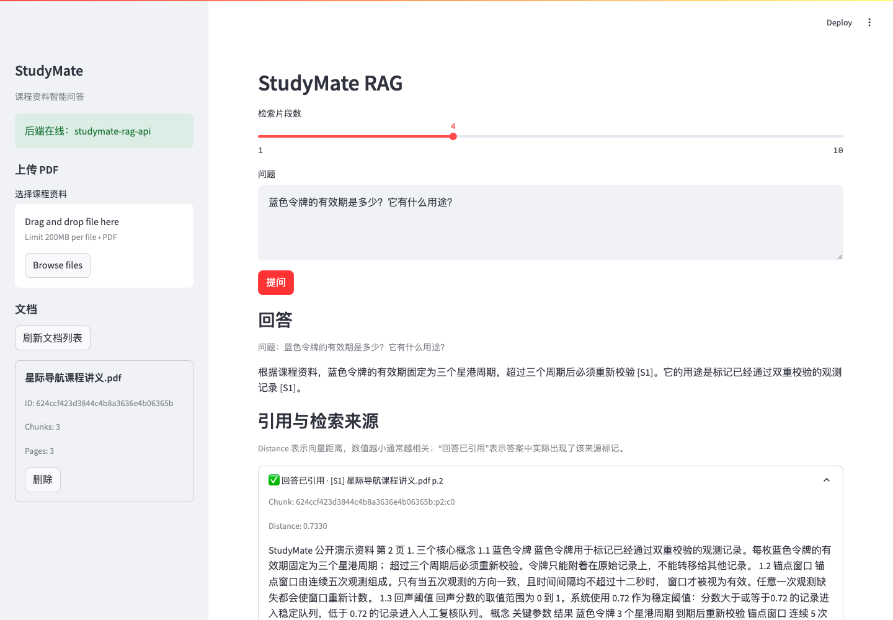

# StudyMate RAG

[](https://github.com/raynegao/StudyMate-RAG/actions/workflows/ci.yml)
[](LICENSE)

StudyMate RAG 是一个面向课程 PDF 的资料问答系统。它使用本地 BGE 模型生成向量、通过 ChromaDB 检索相关片段，再调用 DeepSeek 生成带来源标记的回答。



## English summary

StudyMate RAG is a local-first question-answering system for Chinese course PDFs. It combines `BAAI/bge-small-zh-v1.5` embeddings, ChromaDB retrieval, DeepSeek generation and verifiable page-level citations behind a FastAPI API and Streamlit interface. The repository includes locked Python 3.12 dependencies, non-root Docker images, automated quality gates, a 30-question public benchmark and an isolated real-stack Docker E2E check.

Key evidence:

- 30 questions over 3 fully fictional public PDFs, with gold document, page and answer-keyword annotations
- Recall@1 and MRR@1 of 100% for BGE on the public synthetic benchmark
- 29/30 deterministic keyword checks and 100% cited-page accuracy in the previous recorded DeepSeek benchmark (not a semantic entailment score)
- 15/15 real-course questions retrieve gold-page evidence at top-6 in the local-only benchmark
- 12/12 unsupported questions refused in a separate public regression set
- Isolated Docker verification of real BGE, ChromaDB persistence across backend restart, DeepSeek answers and cleanup
- Machine-readable results and a reproducible 75-second demonstration video

See the [quantitative evaluation](docs/evaluation.md), [architecture](docs/architecture.md), [API contract](docs/api.md) and [75-second demo video](output/demo/studymate-rag-demo-75s.mp4).

## 主要功能

- 分块接收 PDF，并实时限制文件大小
- 保留中文文件名，阻止路径穿越和危险文档 ID
- 识别损坏、加密、无文本和纯扫描 PDF，并返回统一 JSON 错误
- 使用 `BAAI/bge-small-zh-v1.5` 和 ChromaDB 完成语义检索
- API 使用 `[S1]`、`[S2]` 保留原始引用，阅读页面转换为可点击的中文页码
- 原文按页折叠，默认仅展示答案实际使用的出处；本地阅读模式可查看相关原文
- 支持文档列表、幂等删除和删除前二次确认
- 支持本地运行、Docker Compose 和自动化质量检查
- 面向读者的浅色阅读界面、快捷提问方向和中文操作提示；不展示内部 ID、向量距离、片段参数或服务调试信息
- 分块遵守真实 tokenizer 的长度限制；低相关、无引用和越界引用回答按证据不足处理
- 支持选定 PDF 问答、整篇概括，以及可选的仅本地检索模式

## 技术栈

- Python 3.12、FastAPI、Pydantic、Uvicorn
- sentence-transformers、BGE、ChromaDB
- DeepSeek Chat API
- Streamlit
- pytest、Ruff、coverage、Docker Compose

## 快速开始

### 1. 安装运行依赖

项目使用 `uv` 和锁定依赖，避免不同机器上的 Python、Torch 和 gRPC 版本漂移。

```bash
uv venv --python 3.12
uv pip sync --python .venv/bin/python --torch-backend cpu backend/requirements.txt
source .venv/bin/activate
```

开发和测试环境改用开发锁文件：

```bash
uv pip sync --python .venv/bin/python --torch-backend cpu backend/requirements-dev.txt
```

### 2. 配置 DeepSeek

```bash
cp .env.example .env.local
chmod 600 .env.local
```

编辑 `.env.local`，填写 `DEEPSEEK_API_KEY`，然后在启动终端加载：

```bash
set -a
source .env.local
set +a
```

`.env`、`.env.local`、上传文件、Chroma 数据和模型缓存均已被 Git 忽略。

### 3. 本地启动

终端一：

```bash
scripts/run_backend.sh
```

终端二：

```bash
scripts/run_frontend.sh
```

访问：

- Streamlit：`http://127.0.0.1:8501`
- FastAPI 文档：`http://127.0.0.1:8000/docs`

首次上传 PDF 会下载 BGE 模型，耗时取决于网络和磁盘速度。

### 已导入的真实课程资料库

在本机项目目录运行：

```bash
scripts/run_real_course.sh
```

打开 `http://127.0.0.1:8502`，在“我的资料”选择正在阅读的 PDF。后端在 `127.0.0.1:8001`。初始资料包含 3 份 PDF、275 个片段，后续上传的文档继续保留；上传上限 70 MB，具体问题默认检索 6 个片段，数字参数不出现在用户页面。按 Ctrl+C 停止服务，资料保留。

按用户明确授权，这个入口默认启用 DeepSeek，从 `.env.local` 加载凭据，只使用 `real-course-v2` 上传目录、Chroma 目录和 collection，不迁移或重建旧私人索引。重复启动会校验初始回执，不重复导入或覆盖后续上传。首次在其他机器运行，需要填写 `evaluation/private/real-course-sources.json` 的授权来源映射。

在“添加资料”上传后自动选中新 PDF。选择“问资料”输入问题，或切换“概括全文”并点击“生成概括”。三个阅读方向按钮只填写要求，仍需用户点击生成才发送原文。“这份资料的核心概念是什么？”会自动走整篇概括；“总结第三章的公式”这类指定对象的问题按原文检索。具体问题也仅在所选 PDF 内检索。

点击回答会将所选 PDF 的必要原文发送给 DeepSeek；概括会覆盖全部已索引文本，不发送其他 PDF。隐私文档及其回答不写入公开评测记录。不希望内容外发时运行 `scripts/run_real_course.sh local`，该模式只检索原文，明确不生成整篇概括。

概括按页读取全部已索引片段，不受 top-k 限制。每批最多 12000 字符、最多 8 批，多批先分别归纳再综合；超限在任何外发前提示拆分，不截取开头冒充全文。页面显示已阅读的文字页数与原文页码；片段统计仅保留在 API，扫描图片与未提取文字不在覆盖范围。详见 [指定文档问答说明](docs/document-answering.md) 与 [界面改版记录](docs/consumer-ui.md)。

```bash
scripts/run_real_course.sh prepare  # 校验 / 首次导入，不启动服务
scripts/run_real_course.sh verify   # 新库实际 API 的 15 题与隐私边界验收
```

可用 `STUDYMATE_COURSE_BACKEND_PORT` / `STUDYMATE_COURSE_FRONTEND_PORT` 更换端口。普通启动入口仍使用默认资料库，不会自动切换课程库。

### 当前参数与升级边界

默认分块为 300 字符、重叠 60 字符，同时受 384 token（含特殊 token）限制并优先保留句子边界；默认 `top_k=6`。公开生成模式相关性阈值为 0.35，课程本地 profile 使用 0.50。阈值只是相关性过滤，不是“有答案”的概率。

后端通过 `/api/config` 提供运行参数；前端从该接口读取上传上限，并与 Streamlit 实际上限核对。改变 `STUDYMATE_MAX_UPLOAD_SIZE_MB` 后须重启前后端。已有 `.env.local` 的显式配置会覆盖代码默认值，请自行核对非敏感参数；启动脚本不会覆盖该文件。

LLM 默认连接超时最多 5 秒、读写等阶段超时 30 秒，关闭 SDK 自动重试；前端请求等待至少 60 秒，并随后端预算增加。超时返回脱敏 `504/llm_timeout`。这些是阶段超时，不是包括排队、冷启动在内的严格端到端 SLA。新分块策略只影响新上传，旧私人索引不会自动重建。

整篇概括和智能识别的前端等待预算单独提供，默认 330 秒（最多 8 次分段请求与 1 次综合请求）；每次模型调用仍采用上述超时与零重试。短 PDF 通常只需一次调用。生成模式相关性门槛为 0.35，显式课程本地模式为 0.50；概括不经过相似度过滤。

## Docker Compose

```bash
docker compose --env-file .env.local up --build
```

Compose 只构建一份应用镜像，后端和前端复用该镜像。运行时使用非 root 用户，上传目录和 Chroma 目录挂载到宿主机，BGE 缓存在 `studymate_hf_cache` volume 中。

Compose 默认只把 `8000` 和 `8501` 发布到宿主机回环地址 `127.0.0.1`。只有在已经配置防火墙、认证或可信反向代理时，才应显式设置 `STUDYMATE_PUBLISHED_HOST=0.0.0.0`；当前应用没有用户认证，不应直接暴露到公网。

模型缓存完成后，可以在 `.env.local` 中显式开启离线模式：

```dotenv
HF_HUB_OFFLINE=1
TRANSFORMERS_OFFLINE=1
```

停止服务：

```bash
docker compose down
```

## 公开演示资料

仓库包含一份完全虚构、无个人信息的中文样例：

- [studymate-demo-course.pdf](output/pdf/studymate-demo-course.pdf)
- [上传与文档列表截图](output/playwright/studymate-upload-and-documents.png)
- [问答与引用截图](output/playwright/studymate-question-and-citations.png)
- [真实问答验收记录](output/demo/studymate-demo-response.json)
- [75 秒完整演示视频](output/demo/studymate-rag-demo-75s.mp4)

重新生成样例 PDF：

```bash
.venv/bin/python scripts/generate_demo_pdf.py
```

建议问题：

```text
蓝色令牌的有效期是多少？它有什么用途？
```

## 量化评测

仓库包含 3 份完全虚构的公开 PDF 和 30 道中文问题。每道题都标注标准文档、页码和答案关键词，评测脚本使用真实 BGE，并对比字符 n-gram 词法基线、3 组字符上限和 5 组 `top_k`。

前一轮公开合成集记录（以对应 JSON 时间戳为准）：

- BGE Recall@1：100%
- BGE MRR@1：100%
- 该轮 30 次真实 DeepSeek 调用的关键词检查通过率：96.67%（29/30）
- 引用页准确率：100%；关键词与引用联合通过率：96.67%
- 检索、生成延迟及逐题回答以机器可读结果为准，生成会随模型输出和网络波动
- 额外 18 题：12/12 无答案题正确拒答；6/6 可回答变体检索到证据，5/6 通过自动关键词检查

```bash
.venv/bin/python scripts/generate_evaluation_assets.py
.venv/bin/python scripts/evaluate_rag.py

set -a && source .env.local && set +a
.venv/bin/python scripts/evaluate_rag.py --with-llm
.venv/bin/python scripts/evaluate_answerability.py --with-llm
```

完整方法、对比表和局限性见 [docs/evaluation.md](docs/evaluation.md)，机器可读结果见 [evaluation-results.json](output/evaluation/evaluation-results.json)。这些结果来自小规模合成基准，证明可复现性，不代表真实课程域的泛化上限。

拒答回归见 [answerability-evaluation.md](docs/answerability-evaluation.md)。检索命中、关键词检查和引用页支持分别统计，引用标记合法不等于每个断言都受到原文支持。最新两道关键词漏判及标注修订说明见 [优化验收记录](docs/optimization-verification.md)。

### 匿名真实课程评测

仓库另含针对 3 份真实大学课程 PDF、15 道中文问题的匿名检索评测清单（不含原 PDF）。原 PDF、原文件名、本机路径、学校/教师信息和学生数据均不提交；公开内容只有匿名别名、完整性哈希、页码标注和最小答案关键词。评测全程只使用本地 BGE，不向外部 LLM 发送课程内容。

```bash
cp evaluation/real_course_sources.example.json \
  evaluation/private/real-course-sources.json
# 编辑 Git 忽略的映射文件，使 course-a.pdf 等别名指向授权的本地 PDF。
.venv/bin/python scripts/evaluate_real_course.py
```

当前真实课程集 BGE Recall@1 为 `73.33%`，默认 Recall@6 为 `100%`（15/15）；同配置 top-4 为 `86.67%`（13/15）。熵定义题经原文复核后接受两个有效页码，原始页码指标仍单独保留：原始页 Recall@1 为 `66.67%`，Recall@6 为 `100%`。因此 top-1 的标注修订不算算法提升；top-6 的证据覆盖提升可以在原始页口径下成立。完整方法和隐私边界见 [匿名真实课程评测](docs/real-course-evaluation.md)。

## API 示例

上传 PDF：

```bash
curl -X POST http://127.0.0.1:8000/api/upload \
  -F "file=@output/pdf/studymate-demo-course.pdf"
```

提问时可以省略 `top_k`，此时使用 `STUDYMATE_TOP_K`：

```bash
curl -X POST http://127.0.0.1:8000/api/chat \
  -H "Content-Type: application/json" \
  -d '{"question":"蓝色令牌的有效期是多少？"}'
```

来源中的 `distance` 是向量距离，通常越小越相关；`cited=true` 表示答案中实际出现了对应 `citation_id`。

完整接口说明见 [docs/api.md](docs/api.md)。

## 测试与验证

```bash
scripts/test.sh
docker compose config --quiet
docker build --check .
.venv/bin/python scripts/run_docker_e2e.py
.venv/bin/python scripts/evaluate_real_course.py
scripts/run_real_course.sh verify
.venv/bin/python scripts/verify_token_budget.py
```

`scripts/test.sh` 会依次执行 Ruff、`compileall`、pytest coverage 和依赖一致性检查。CI 使用 Python 3.12，并要求后端覆盖率不低于 70%。

`scripts/run_docker_e2e.py` 使用临时上传与 Chroma 目录启动隔离 Compose 项目，自动验证真实 BGE、真实 DeepSeek、前后端健康、后端重启持久化、文档删除和清理。GitHub 的 `Real-stack E2E` workflow 可以在配置仓库 Secret 后手动运行，不会让外部 API 依赖阻塞常规 CI。

2026-09-06 的消费端界面更新：128 项测试通过，后端覆盖率 87.25%；完成桌面、390 像素窄屏和隔离 Docker 真实栈检查。页码引用、用户化错误文案与操作回归见 [界面改版记录](docs/consumer-ui.md)。

2026-09-05 的指定文档问答更新：当时 98 项测试通过，后端覆盖率 87.25%。新增真实 Chroma 文档隔离、整篇尾部覆盖、分批概括、引用校验、本地模式保护和 Streamlit 选择/旧答案隔离测试；Docker E2E 增加选定 PDF 的真实 DeepSeek 概括。还修复 V4 思考占满旧输出预算导致正文为空的问题：概括使用非思考模式，具体问答保留思考，两者输出上限均为 4096 token，并拒绝截断输出。最终公开 30 题回归的关键词和引用页检查均为 30/30，见 [本次回归](docs/document-answering-regression.md)；小样本结果不代表普遍正确。前一轮历史验收保留在 [优化验收记录](docs/optimization-verification.md)。

## 项目结构

```text
backend/app/api/          上传、问答和文档管理接口
backend/app/core/         配置、日志和统一错误处理
backend/app/models/       Pydantic 请求与响应模型
backend/app/services/     PDF、chunk、embedding、Chroma 和 RAG 流程
frontend/                 Streamlit 页面
scripts/                  启动、测试、smoke 和样例生成脚本
config/profiles/           不含密钥的专用运行配置
tests/                    API、服务层和前端辅助函数测试
docs/                     架构、API、演示和简历材料
evaluation/               公开合成基准、匿名真实课程清单和 Git 忽略的私有映射
output/                   可公开使用的样例、截图与脱敏评测结果
data/                     本地上传文件和 Chroma 数据，不提交内容
```

## 当前边界

当前版本为 `0.3.0`，聚焦稳定的单知识库 PDF 问答闭环，不包含 OCR、Hybrid Search、Rerank、Query Rewrite、多轮记忆、用户系统或云部署。

## License

This project is released under the [MIT License](LICENSE).
