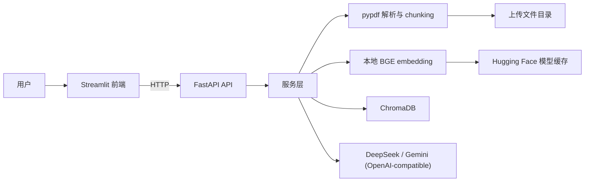
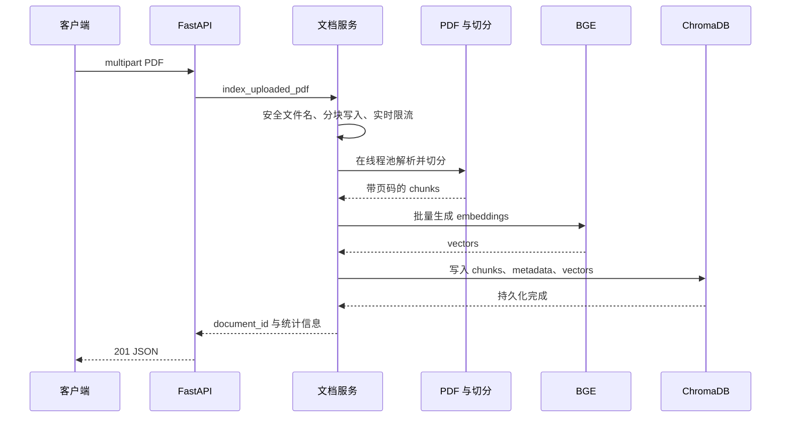
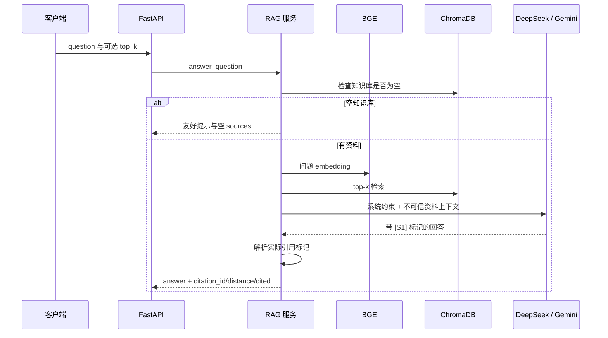

# StudyMate RAG 架构

## 目标与边界

当前版本实现单知识库 PDF 问答闭环：上传、解析、切分、向量化、检索、生成回答和引用展示。OCR、Hybrid Search、Rerank、Query Rewrite、多轮记忆和多知识库不在本版本范围内。

## 系统结构

## 模块职责

- `api/`：HTTP 参数、响应 schema、线程池调度和错误转换
- `services/document_service.py`：上传文件落盘与索引事务
- `services/pdf_parser.py`：损坏、加密和无文本 PDF 分类
- `services/chunking.py`：按页切分，保留页码、文件名和 chunk ID；近边界优先句子结束位置
- `services/embedding_service.py`：延迟加载 BGE，用实际 tokenizer 约束分块；禁止输入静默截断
- `services/vector_store.py`：Chroma CRUD 和距离返回
- `services/rag_service.py`：空库短路、相关性过滤、本地检索模式、生成与引用有效性检查
- `services/summary_service.py`：概览识别、指定 PDF 按页读取、全量分批归纳与综合、原始引用校验；超限在外发前失败
- `services/llm_service.py`：回答模型客户端（DeepSeek 或 Gemini，OpenAI 兼容接口）与系统级安全约束
- `core/errors.py`：类型化服务异常和统一 JSON 错误

## 上传流程

上传、解析、embedding 或 Chroma 任一步失败，都会删除本次残留文件。同步的 PDF、模型、Chroma 和 LLM 工作通过线程池移出 FastAPI 事件循环。

## 问答与引用

系统消息明确把 PDF 内容视为不可信资料，并要求忽略资料正文中的指令。API 保留原始引用编号、`cited`、向量距离等机器字段。前端展示层根据答案中实际出现的编号匹配来源，转成中文页码链接并按文件、页码分组；不改写原文或持久化数据，不展示候选片段的调试信息。本地阅读模式单独展示所有返回的相关原文。错误通过前端白名单转换为消费端文案，不透传原始错误消息、响应正文或内部地址。

上图展示 generation 具体问题主路径。新版页面携带所选 `document_id`，查询在 Chroma 中先按该 ID 过滤，再做 top-k 与相关性门槛筛选；不回退到其他文档。在 `retrieval_only` 模式下直接返回本地片段。在 generation 模式下，缺失引用或越界引用会降级为“证据不足”。语法正确的引用不等同于语义支持。

概览问题在 embedding 之前分流到 summary 服务：指定文档全部已索引片段 → 按页排序 → 预算预检 → 最多 8 批原文归纳 → 多批时综合 → 原始引用与覆盖元数据。它不把 6 个相似片段当作整篇。同步调用仍在 FastAPI 线程池内；前端概括等待预算与单次 LLM 超时分开配置。

默认分块使用 300 字符、60 字符重叠，并同时满足最多 384 tokens（含特殊 token）与模型输入上限。句子结束位置只有接近切分边界时才优先采用，避免丢失大段上下文。默认 Top K 为 6。BGE 查询前缀未启用，因为本地对比未证明它在默认返回量下有稳定收益。

## 存储和容器

- 上传文件：`data/uploads/`
- Chroma 索引：`data/chroma_db/`
- 文档库入口：`scripts/run_real_course.sh` 按用户明确授权启用智能回答（DeepSeek 或 Gemini），从 `.env.local` 安全加载 Key；`local`、`prepare`、`verify` 保持纯本地。复用 `real-course-v2` 存储和后续上传，不读取或重建旧私人索引；前端只发送所选 PDF
- 课程库每个服务进程仍只连接一个资料库；此入口不引入多知识库切换功能
- BGE 缓存：Docker named volume `studymate_hf_cache`
- 宿主机目录可通过 `STUDYMATE_HOST_UPLOAD_DIR` 和 `STUDYMATE_HOST_CHROMA_DIR` 覆盖
- 模型卷名称可通过 `STUDYMATE_HF_CACHE_VOLUME` 覆盖，方便隔离验收
- Compose 发布端口默认绑定 `127.0.0.1`；只有在额外访问控制就绪后才通过 `STUDYMATE_PUBLISHED_HOST` 改为其他地址

Compose 的后端和前端复用同一生产镜像。镜像只安装运行依赖，并以 UID/GID 10001 的非 root 用户启动。首次下载模型时保持在线；缓存完整后才设置 `HF_HUB_OFFLINE=1` 和 `TRANSFORMERS_OFFLINE=1`。

## 依赖与质量门禁

- Python 固定为 3.12
- `requirements.txt` 为运行锁，`requirements-dev.txt` 为开发锁
- CI 执行 Ruff、`compileall`、pytest coverage、Compose 配置和 Dockerfile 检查
- 后端覆盖率阈值为 70%
- `evaluation/benchmark.json` 提供 30 题公开标注，`scripts/evaluate_rag.py` 使用真实 BGE 计算 Recall@K、MRR、延迟和真实 DeepSeek 的答案/引用指标
- `evaluation/real_course_benchmark.json` 提供 15 题匿名真实课程标注，`scripts/evaluate_real_course.py` 从 Git 忽略的本机映射读取原 PDF，只运行本地检索并输出脱敏指标
- `scripts/run_docker_e2e.py` 在临时数据目录中自动验证前后端、真实模型、Chroma 重启持久化与删除清理
- `scripts/evaluate_answerability.py` 使用额外 18 道公开问题验证资料外问题、同主题缺失事实及可回答变体，调用与 API 相同的回答逻辑
- `scripts/run_real_course.sh verify` 在新进程中检查真实课程 API 检索、275 个片段的 token 上限和本地模式，报告不包含课程原文
- `Real-stack E2E` GitHub workflow 采用手动触发，避免 Secret 和外部模型网络波动影响常规 CI
